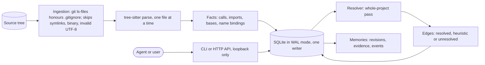
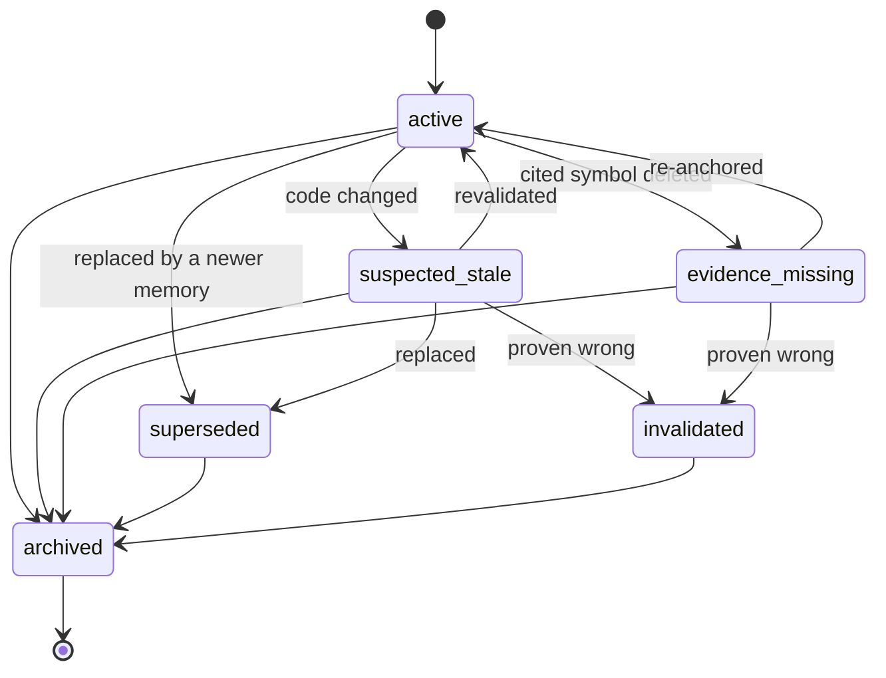

# Veylqora

**Veylqora is a local code-intelligence service with persistent memory for AI coding agents.**

It indexes a repository's code (symbols, calls, imports, inheritance), stores what
an agent has learned about that code as structured memories, and keeps each
memory tied to the code it was based on. When that code later changes, the
memories that depend on it are the ones in question. The design goal is to tell
an agent *which* stored knowledge may be stale, instead of having it trust the
notes blindly or ignore them.

**Status (October 2026): Phases 1 and 2 are certified, and the core system works end to end.** Phase 3 is partly done. In a controlled study on 10 seeded bugs, an AI coding agent connected to Veylqora, used its tools in 30 runs (49 calls), and every run completed cleanly with no timeouts or edited tests. The study did not yet show that the tools raise the agent's pass rate: 5/10 without the tools, 6/10 with search and memory, 4/10 with search alone and 3/10 with the context package. Ten bugs with one run each is too small to tell these apart, so a larger study is planned. See [Current implementation](#current-implementation) and the [agent study notes](study/README.md).

---

## The problem

AI coding agents lose context between sessions. In practice this shows up as:

- **Re-investigation.** The agent re-reads the same files and re-discovers the same
  facts every session, spending tokens and time on work it already did.
- **Stale notes.** A note saying "the token check is in `auth.py`" stays in the
  notes after the function is renamed, moved, or rewritten. The agent acts on it.
- **Irrelevant retrieval.** Searching by text returns the word "token" in twenty
  places; the agent cannot tell which one matters for the task.
- **No provenance.** Nothing records *why* a decision was made, *who* made it, or
  *what code it assumed*.

Veylqora addresses each of these with a persistent, queryable model of the code
and of the agent's knowledge, linked together.

## How it helps

| Need | What Veylqora provides |
|---|---|
| Find the code that matters | Exact symbol lookup; graph queries for who calls or depends on a name |
| Understand relationships | Calls, imports, inheritance and containment, each with a confidence level |
| Keep knowledge across sessions | Memories with revisions, state, author and reason, stored in SQLite |
| Know when knowledge is stale | Memories cite the symbols they rely on, with a fingerprint of their body at the time. A change to a cited symbol is detectable (Phase 2 acts on it) |
| Don't trust guesses | Every graph edge is marked `resolved`, `heuristic` (a guess) or `unresolved`. The tool never presents a guess as fact |
| Audit and recover | Every memory change is recorded. Export and import are deterministic and byte-identical on round trip |
| Stay local and private | No network calls for indexing, graph or memory. Nothing leaves the machine |

## How it works



1. **Ingestion.** Inside a git work tree, the file list comes from `git ls-files`, so
   `.gitignore` rules apply exactly as git applies them. Symlinks are never followed.
   Binary files, non-UTF-8 files and files over 1 MiB are skipped with a warning.
2. **Parsing.** Each Python file is parsed with tree-sitter. The parser records
   symbols (modules, classes, functions, methods, with dotted names), call sites,
   inheritance, and what each import binds to. A file with syntax errors is still
   indexed for its valid parts.
3. **Resolution.** After a run that changed something, a whole-project pass turns
   the recorded facts into edges. A name bound by an import in the same file is
   `resolved`. A name defined in the same file is `resolved`. A method called on an
   unknown receiver is `heuristic`, linked to at most five candidates. Anything else
   is `unresolved`. Package re-exports are followed for a bounded number of hops.
4. **Memory.** A memory has a type, content, author, scope and state. It can cite
   indexed symbols as evidence; a citation that names nothing indexed is rejected
   and the whole memory is not created. Updates use optimistic concurrency: a writer
   names the revision it read, and a stale write is refused with a conflict rather
   than silently overwriting.
5. **State machine.** States are `active`, `suspected_stale`, `superseded`,
   `invalidated`, `evidence_missing` and `archived`. Only the transitions in the
   table are allowed, and each needs a reason. A code change can raise a question
   (`active → suspected_stale`); answering it is a separate, recorded decision.



## Test results

Last full CI run on the code in this repository (cloud sandbox, Ubuntu 26.04,
gcc 15.2 and clang 21.1):

| Job | Result |
|---|---|
| clang-format check | PASS |
| gcc 15 build, `-Werror`, all tests | PASS — 71 / 71 |
| clang 21 build, `-Werror`, all tests | PASS — 71 / 71 |
| AddressSanitizer + UndefinedBehaviorSanitizer, all tests | PASS — 71 / 71 |
| Certification records verify | PASS (records for older commits are reported as stale warnings) |

The 71 tests cover: identity and fingerprints; the Python parser; repository
ingestion (empty, large, binary, invalid UTF-8, symlinks, renames, deletions,
`.gitignore`, interrupted runs, unreadable files); the code graph against a
hand-labelled fixture (precision and recall both 1.0 on that fixture, a gate of 0.95); memory
rules (revision conflicts, transitions, evidence rollback, restart, isolation,
retention, byte-identical export and import); the HTTP API on a live port with
its error codes; the single-writer lock; and a CLI integration script.

**Measured on public repositories** (shallow clones, cloud sandbox):

| Project | Python files | Symbols | First index | Re-index |
|---|---|---|---|---|
| psf/requests | 37 | 844 | 0.3 s | 0.0 s |
| pallets/flask | 83 | 1,705 | 0.3 s | 0.0 s |
| django/django | 2,933 | 46,906 | 24 s | 0.3 s |

Graph lookups on django take 5–40 ms, including opening the database. The
results are in `docs/research/`.

## Agent study results

A controlled study on 10 seeded bugs in click (40 runs, one per task and setup), with an AI coding agent. The agent connected to Veylqora and used its tools in 30 runs (49 calls), and every run completed cleanly.

| Setup | Passed |
|---|---|
| A (no Veylqora tools) | 5/10 |
| B (code search) | 4/10 |
| C (search + memory) | 6/10 |
| D (context package) | 3/10 |

The study does not yet show that the tools raise the pass rate. Ten bugs with one run each is too small. Details and how to run it: [study/README.md](study/README.md).

## Tech stack

| Area | Choice | Why |
|---|---|---|
| Core language | C++20 | Performance and predictable memory use for an indexing service |
| Build | CMake ≥ 3.28, Ninja | Standard for C++; FetchContent pins dependencies by tag or SHA-256 |
| Storage | SQLite 3 (WAL, foreign keys, forward-only migrations) | One file, transactional, no server to run |
| Parsing | tree-sitter v0.27.1 + tree-sitter-python v0.25.0 (MIT) | Incremental, error-tolerant, fast |
| HTTP | cpp-httplib v0.62.0 (MIT) | Header-only; loopback API |
| JSON | nlohmann/json v3.12.0 (MIT) | Wire format for the CLI and API |
| Tests | Catch2 v3.11.0 | C++ unit and integration tests |
| Quality gates | `-Wall -Wextra -Wconversion … -Werror`, clang-format, ASan + UBSan | Warnings are errors for first-party code |
| Web UI | React 19, TypeScript 5.9, Vite 7, Vitest | Read-only dashboard served by the daemon |
| CI | Cloud sandbox running `scripts/ci.sh` (no hosted runner) | Reproducible; see ADR-0005 |

Planned, not yet in the code: USearch (vector index, ADR-0002) for semantic
search, and an MCP server (ADR-0007) for AI coding clients.

## Current implementation

Each module is certified by `scripts/certify.py`, which runs the checks at a pushed commit and
records the result under `docs/certification/`.

| Module | What it delivers | Status |
|---|---|---|
| M0.1 | Build skeleton, warnings-as-errors, sanitizer wiring, dependency pins | PASS (`ea0c9f8`) |
| M0.2 | Certification system: `certify.py`, `verify_certs.py`, tamper detection | PASS (module 0.1) |
| S1–S4 | Spikes: symbol identity, evidence anchoring, vector delete/recall, MCP handshake | Decided in ADR-0003, 0002, 0007 |
| M1.1 | Core runtime, SQLite schema and migrations, Python indexing, CLI slice | PASS (`33d38a0`) |
| M1.2 | Git-aware ingestion, classification, batched and cancellable indexing | PASS (`f96228c`) |
| M1.3a | Python code graph: tree-sitter symbols, edges with confidence, queries | PASS (`5d89627`) |
| M1.4 | Memory engine: revisions, CAS, state machine, evidence, retention, JSONL export/import | PASS (`2c84c51`) |
| M1.5 | Local HTTP API, `veylqora` CLI with `--json`, single-writer file lock | PASS (`6027d9a`) |
| M1.6 | Read-only React dashboard served by the daemon | PASS (`19f50cf`) |
| M1.3b | JavaScript and TypeScript graph: tree-sitter JS and TS, per-language labelled gate (ADR-0019) | PASS (`25d3a7f`) |
| Phase 2 | Hybrid retrieval, incremental index maintenance, evidence invalidation, MCP server (two named clients), context packaging, multi-agent coordination, observability | PASS: M2.1–M2.7 certified (M2.5 at `dc6628e`, M2.7 at `903a267`) |
| Phase 3 | Hardening, benchmarks, packaging and Docker, offline evaluation | Partly done: M3.1, M3.2, M3.3, M3.4, M3.5a and M3.6a certified |
| M3.5 | PolyFabric and StructZero adapters | M3.5a (generic outbound bridge) certified; product adapters blocked: need their contract documents |
| M3.6b | Agent comparison study | Full study run (40 runs); results in [study/README.md](study/README.md); a larger study is planned |

### Command line

```bash
veylqora init --db veylqora.db
veylqora index ./my-repo --db veylqora.db
veylqora search verify_token --root ./my-repo --db veylqora.db
veylqora graph verify_token --root ./my-repo --db veylqora.db
veylqora status --root ./my-repo --db veylqora.db

veylqora memory add --root ./my-repo --db veylqora.db --type decision \
  --content "tokens are prefixed" --author agent-a --evidence "auth/tokens.py:auth.tokens.verify_token"
veylqora memory list --root ./my-repo --db veylqora.db
veylqora memory inspect <id> --root ./my-repo --db veylqora.db
veylqora memory export memories.jsonl --root ./my-repo --db veylqora.db

veylqora serve --db veylqora.db --port 8765     # daemon; the only writer while running
veylqora status --root ./my-repo --server http://127.0.0.1:8765
```

Add `--json` to any command for machine-readable output. Exit codes: `0` ok,
`1` error, `2` usage, `3` not found, `4` conflict.

### HTTP API (loopback only)

`GET /api/v1/health`, `GET /api/v1/status`, `POST /api/v1/index`,
`GET /api/v1/search`, `GET /api/v1/graph`, `GET /api/v1/doctor`,
`GET|POST /api/v1/memories`, `GET /api/v1/memories/{id}`,
`POST /api/v1/memories/{id}/update`, `POST /api/v1/memories/{id}/transition`.

Errors are returned as `{"error":{"code":"…","message":"…"}}` with a status of
400 (invalid), 404 (not found) or 409 (revision conflict).

## Known limitations

- **Languages.** Python, JavaScript and TypeScript are indexed (M1.3b). Other languages are not.
- **Name-based, not type-based.** Calls on objects of unknown type are heuristic.
  Dynamic dispatch, `getattr`, and runtime imports are not modelled.
- **Semantic search.** Phase 2 adds hybrid retrieval. Vector (semantic) search is still planned (ADR-0002).
- **Nothing acts on staleness yet.** Memories can be marked suspected-stale by
  hand; automatic detection after code changes is Phase 2 (M2.3).
- **No secret redaction yet.** Indexed source and memory content are stored as
  given. Redaction at ingest is planned.
- **No authentication.** The HTTP API accepts loopback connections only. Remote
  exposure is refused until authentication exists (ADR-0012 is planned).
- **Storage cost.** The graph roughly triples indexing time and multiplies storage
  by about eight on django. Recorded in `docs/research/graph-m1.3a.txt`.
- **Windows.** The CLI builds with MSVC in principle, but CI and the sanitizer
  gates run on Linux only (ADR-0001).

## Decisions and documentation

| File | Contents |
|---|---|
| [`docs/adr/`](docs/adr/) | Architecture decisions, each with evidence and reversal criteria |
| [`docs/certification/`](docs/certification/) | Certification manifests and logs per module and commit |
| [`docs/research/`](docs/research/) | Measurements on public repositories and spike results |
| [`docs/SECURITY.md`](docs/SECURITY.md) | Threat model, controls in place, known gaps |

## Build and test

Requirements: CMake ≥ 3.28, Ninja, a C++20 compiler (gcc 13+ or clang 17+),
SQLite development headers, and network access on the first build (dependencies
are fetched and pinned).

```bash
cmake -S . -B build -G Ninja -DCMAKE_BUILD_TYPE=RelWithDebInfo
cmake --build build -j
ctest --test-dir build --output-on-failure
```

Sanitizer build:

```bash
cmake -S . -B build-san -G Ninja -DCMAKE_BUILD_TYPE=Debug \
  -DCMAKE_CXX_COMPILER=clang++ -DVEYLQORA_SANITIZER=address+undefined
cmake --build build-san -j && ctest --test-dir build-san --output-on-failure
```

Full gated run, in the cloud sandbox used for CI: `scripts/ci.sh`.

## Roadmap

- **v0.1 (Phase 1):** complete M1.6 certification, then tag the release.
- **v0.2 (Phase 2):** TypeScript and JavaScript graph; hybrid retrieval with a local
  embedding model; detection of stale memories after code changes, with
  revalidation; an MCP server so coding agents can call Veylqora directly; context
  packages that fit a token budget; coordination between several agents.
- **v0.3 (Phase 3):** performance benchmarks at several corpus sizes, security
  review and sanitizer fuzzing, Docker packaging and backup/restore, an offline
  evaluation of retrieval quality, and the PolyFabric and StructZero integrations
  once their contracts are available.

## Licence

Apache-2.0. See [`LICENSE`](LICENSE).
