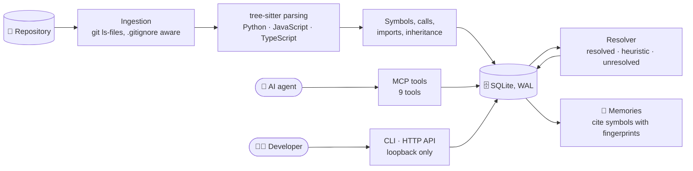
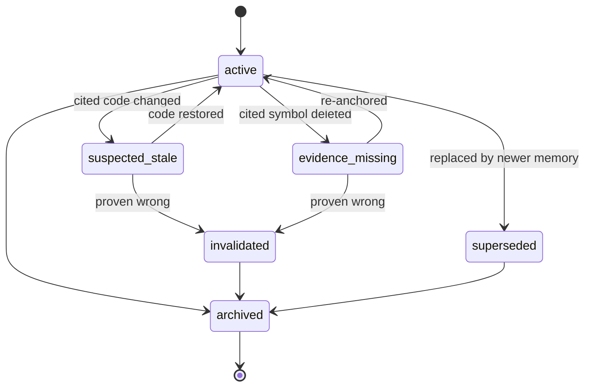
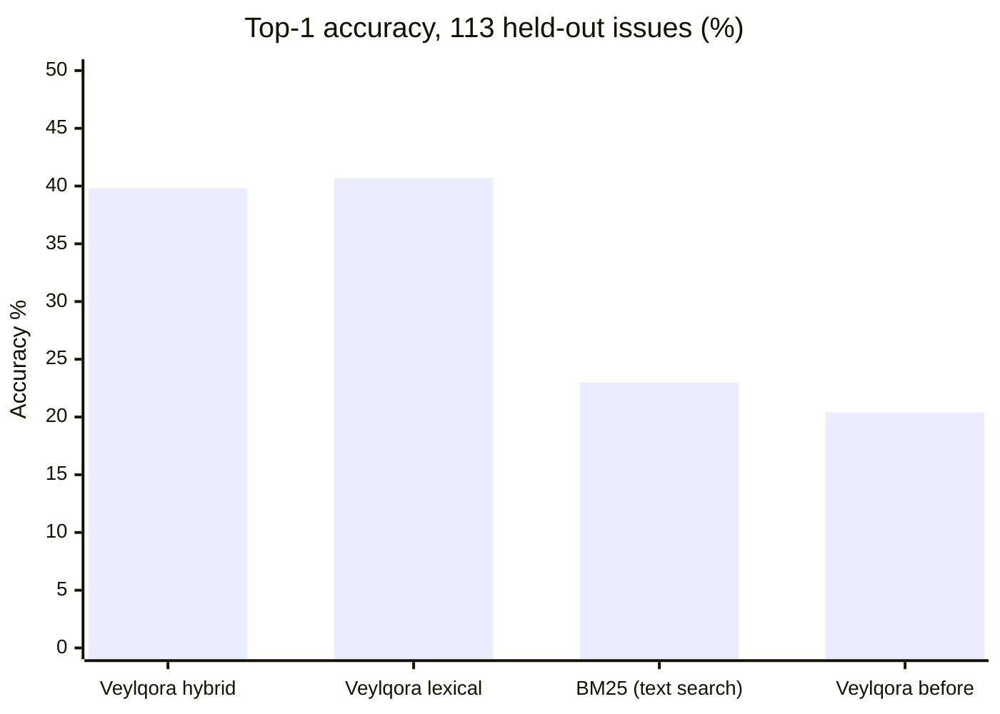
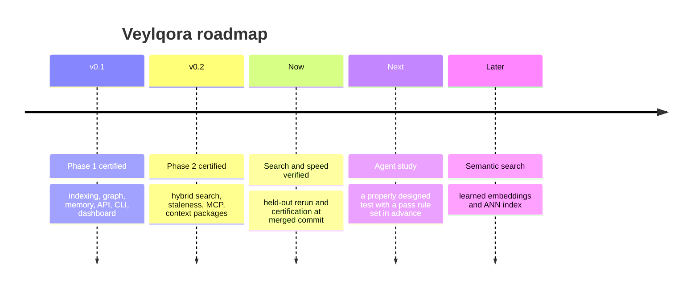

# Veylqora

**A local code-intelligence service with persistent, staleness-aware memory for AI coding agents.**

Veylqora indexes a repository's code, stores what an agent learns as structured memories, and ties each memory to the exact code it depends on. When that code changes, the affected memories are flagged `suspected_stale` instead of being trusted blindly.

> **Status (October 2026):** 20 of 21 modules are certified at `ccdd012`: Phase 1, Phase 2 and Phase 3 except `1.6`, whose UI tests pass in CI but whose local certification check could not run on this machine. Search and indexing speed are verified on held-out data. Whether Veylqora makes AI agents more successful is **not yet proven**. See [What is proven](#-what-is-proven).

---

## ✨ At a glance

| | |
|---|---|
| 🔎 **Finds the right file** | 40% top-1 on 113 unseen real bug reports, vs 23% for plain text search |
| ⚡ **Indexes fast** | 8–12× faster than the previous version on three large projects |
| 🧠 **Remembers, and warns** | memories flag themselves when the code they cite changes |
| 🔒 **Stays local** | no network calls for indexing, search or memory; loopback-only API |
| 🧪 **Tested** | 105 C++ tests (gcc, clang, sanitizers), 20 MCP tests, web and adapter tests |

---

## 🧭 How it works



**Memory lifecycle.** A memory's state changes only through allowed transitions, and each one is recorded.



**Key ideas**
- **Evidence is anchored.** Each memory stores a fingerprint of the code it cites. Comments and whitespace are ignored.
- **Honest edges.** Every graph link is labelled `resolved`, `heuristic` (a guess) or `unresolved`. A guess is never shown as fact.
- **Single writer.** One daemon owns the database, guarded by a file lock.

---

## 🚀 Quick start

**Build** (Linux, or Docker; see [Docker](#-docker)):

```bash
cmake -S . -B build -G Ninja -DCMAKE_BUILD_TYPE=RelWithDebInfo
cmake --build build -j
ctest --test-dir build --output-on-failure
```

**Use it:**

```bash
veylqora init --db veylqora.db
veylqora index ./my-repo --db veylqora.db
veylqora search verify_token --root ./my-repo --db veylqora.db
veylqora graph verify_token --root ./my-repo --db veylqora.db

veylqora memory add --root ./my-repo --db veylqora.db --type decision \
  --content "tokens are prefixed" --author agent-a \
  --evidence "auth/tokens.py:auth.tokens.verify_token"

veylqora serve --db veylqora.db --port 8765    # the only writer while running
```

Add `--json` to any command for machine-readable output. Exit codes: `0` ok · `1` error · `2` usage · `3` not found · `4` conflict.

**Connect an AI agent (MCP):** the server is in `mcp/veylqora_mcp/server.py`. It exposes nine tools: `get_project_status`, `search_code`, `inspect_symbol`, `find_dependencies`, `search_memories`, `record_memory`, `inspect_evidence`, `check_memory_validity` and `get_task_context`. Set `VEYLQORA_URL`, and optionally `VEYLQORA_DEFAULT_ROOT` and `VEYLQORA_AGENT`.

---

## 📊 Results

### 🔎 Finding the right file: 113 held-out real bug reports

Given a real GitHub bug report, rank the repository's Python files. The check is whether the file the real fix changed lands at the top. No language model is used.



| Method | Top 1 | Top 5 | Top 10 | MRR |
|---|---:|---:|---:|---:|
| **Veylqora lexical** | **40.7%** | 66.4% | 77.0% | **0.529** |
| **Veylqora hybrid** | **39.8%** | **67.3%** | 75.2% | 0.520 |
| BM25 over files | 23.0% | 53.1% | 63.7% | 0.380 |
| Veylqora hybrid, before these changes | 20.4% | 44.2% | 56.6% | 0.325 |

**Hybrid minus BM25, 95% intervals over issues:** top 1 **+16.8** points [+7.1, +26.5] · top 5 **+14.2** [+4.4, +23.9] · top 10 **+11.5** [+2.7, +20.4]. Every interval excludes zero.

> ⚠️ **Limits.** The 113 issues were not used for tuning, but they come from the same benchmark as an earlier diagnostic sample, so the set is not fully blind. The tuning set was 25 issues. Several repositories contribute only 1–3 issues. An independent rerun by a second agent reproduced every issue's rank exactly; a rerun by a human is still pending.

### ⚡ Indexing speed

Median of 5 alternating runs, Release build, quiet machine, same checkouts.

```mermaid
xychart-beta
    title "Indexing time, seconds (lower is better)"
    x-axis ["pylint 1093 files", "sphinx 658 files", "astropy 914 files"]
    y-axis "Seconds" 0 --> 90
    bar [25.75, 31.64, 83.89]
    bar [2.17, 3.03, 10.59]
```



| Repository | Before | After | Speed-up |
|---|---:|---:|---:|
| pylint (1,093 files) | 25.75 s | 2.17 s | **11.9×** |
| sphinx (658 files) | 31.64 s | 3.03 s | **10.4×** |
| astropy (914 files) | 83.89 s | 10.59 s | **7.9×** |

**Same answers:** across 6 checkouts and 24 queries, the indexed files, symbol counts, token rows and all 48 ranked lists are identical before and after the speed change (GCC 15.2 for every build).

### 🤖 Do AI agents do better with Veylqora? (not yet proven)

A study on 10 seeded bugs in `click` (40 runs) and 10 in `pygments` (40 runs):

| Setup | click | pygments |
|---|---:|---:|
| A · built-in tools only | 5/10 | 8/10 |
| B · + code search | 4/10 | 8/10 |
| C · + search and memory | 6/10 | 9/10 |
| D · + context package | 3/10 | 8/10 |

No difference is distinguishable from chance. Several tasks were too easy, some had wrong descriptions, and each setup ran once per task. See [`study/README.md`](study/README.md).

---

## ✅ Quality and certification

| Check | Result | Measured at |
|---|---|---|
| C++ tests, gcc 15 (`-Werror`) | ✅ 105 / 105 | `0239d13` |
| C++ tests, clang 21 (`-Werror`) | ✅ 105 / 105 | `0239d13` |
| C++ tests, ASan + UBSan | ✅ 105 / 105 | `0239d13` |
| MCP server tests (pytest) | ✅ 20 / 20 | `0239d13` |
| Offline evaluation gates | ✅ recall@10 1.000 · stale precision 1.000 · recall 1.000 | `0239d13` |
| End-to-end: install, index, MCP, restart, backup | ✅ 7 / 7 steps | `0239d13` |
| Web dashboard: Vitest + Playwright | ✅ 9 unit · 6 browser | `0239d13` |
| Outbound adapter contract tests | ✅ 9 / 9 | `0239d13` |

Certification manifests live in [`docs/certification/`](docs/certification/). Verify them with `python3 scripts/verify_certs.py`.

> ℹ️ `verify_certs.py` still warns for module `1.6` at `ccdd012a`: its compile, MCP, web-CI and adapter checks pass, but the local web check runs `npx vitest` over the whole `web/` project, which also collects the browser suite in `web/e2e`; that suite needs a daemon binary and fixtures that were not available on the certifying machine. The dashboard itself passed in CI (9 unit, 6 browser tests). Every other module has a PASS record at `ccdd012a`.

### 🧩 What is proven

| Claim | Status |
|---|---|
| Search finds the right file more often than plain text search | ✅ **proven** on 113 held-out issues, rerun reproduced exactly |
| Indexing is faster and gives the same answers | ✅ **proven** on 6 checkouts |
| The code passes its own tests on each commit | ✅ **proven** at `0239d13` |
| Memories flag themselves when the code they cite changes | 🟡 measured on 84 real-history cases: precision 88% (79-97%), recall 100%, known limitation: moved code is inconsistent (2 of 3 flagged wrongly) |
| AI agents fix more bugs with Veylqora | ❌ **not proven** — pilot, not certified: 50% without Veylqora, 39% with it |

---

## 🧱 Tech stack

| Area | Choice | Why |
|---|---|---|
| Core | C++20 | predictable performance for an indexing service |
| Build | CMake ≥ 3.28 · Ninja | standard; dependencies pinned by tag or SHA-256 |
| Storage | SQLite 3, WAL mode | one file, transactional, nothing to run |
| Parsing | tree-sitter · Python, JavaScript, TypeScript grammars | incremental and error-tolerant |
| HTTP | cpp-httplib (loopback only) | small, header-only |
| Search | IDF-weighted lexical · hashed-token vector · one-hop graph, fused by reciprocal rank | see [ADR-0015](docs/adr/0015-hybrid-retrieval.md) |
| MCP server | Python `mcp` SDK | exposes tools over stdio |
| Web UI | React 19 · TypeScript 5.9 · Vite 7 · Cytoscape | read-only dashboard served by the daemon |
| Tests | Catch2 · pytest · Vitest · Playwright | C++, MCP, web and browser suites |
| Quality gates | `-Wall -Wextra -Wconversion -Werror`, clang-format, ASan + UBSan | warnings are errors |

> 🔭 **Planned, not in the code yet:** a learned embedding model and an approximate-nearest-neighbour index for semantic search ([ADR-0002](docs/adr/0002-dependencies.md)).

---

## 🐳 Docker

```bash
docker compose up -d veylqora                       # no ports published: loopback only
docker compose exec veylqora veylqora status --root /workspace --server http://127.0.0.1:8765
```

The project folder is mounted read-only at `/workspace` (set `VEYLQORA_WORKSPACE`). Backup, restore and upgrade procedures are in [`docs/OPERATIONS.md`](docs/OPERATIONS.md).

---

## 🗺️ Roadmap



---

## ⚠️ Known limitations

- **Languages:** Python, JavaScript and TypeScript are indexed. Other languages are not.
- **Search is not semantic yet.** Vector search matches shared identifiers only, so a query sharing no words with its target cannot match it.
- **Staleness covers cited bodies only.** A change in code the cited symbol calls is not detected ([ADR-0014](docs/adr/0014-evidence-invalidation.md)).
- **No conflict detection.** Two memories that contradict each other are not flagged automatically.
- **No authentication.** The API accepts loopback connections only.
- **No secret redaction.** Indexed source and memory text are stored as given. Keep the database private.
- **Single-threaded graph resolution.** Re-indexing after a large change can still be slow.
- **Windows.** The database lock supports Windows, but CI and sanitizer gates run on Linux only ([ADR-0001](docs/adr/0001-platforms.md)).

---

## 📚 Documentation

| Document | Contents |
|---|---|
| [`docs/adr/`](docs/adr/) | architecture decisions, each with evidence and reversal criteria |
| [`docs/certification/`](docs/certification/) | certification manifests and logs per module and commit |
| [`docs/research/`](docs/research/) | measurements on public repositories and spike results |
| [`docs/OPERATIONS.md`](docs/OPERATIONS.md) | backup, restore, upgrade, rollback |
| [`docs/SECURITY.md`](docs/SECURITY.md) | threat model, controls in place, known gaps |
| [`study/README.md`](study/README.md) | the agent study: design, results, limits |
| [`evaluation/README.md`](evaluation/README.md) | offline evaluation and its limits |

---

## 📄 Licence

Apache-2.0. See [`LICENSE`](LICENSE).
